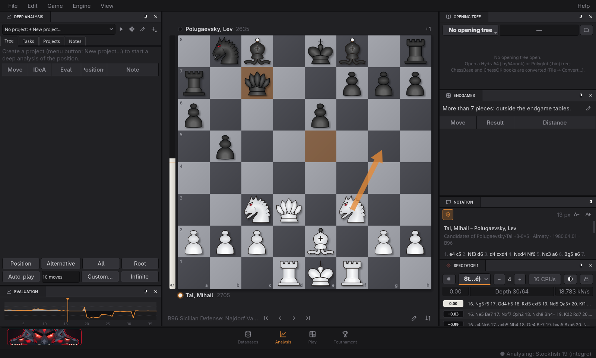
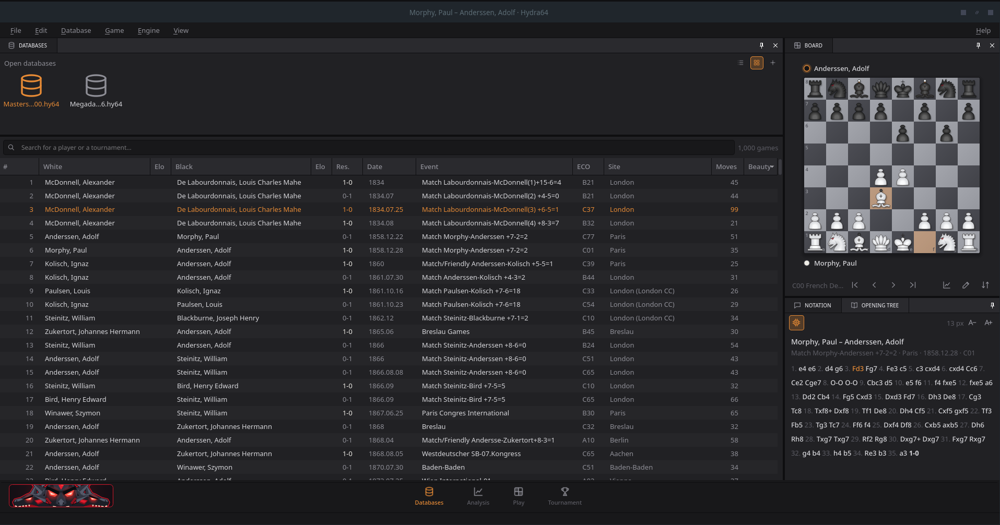
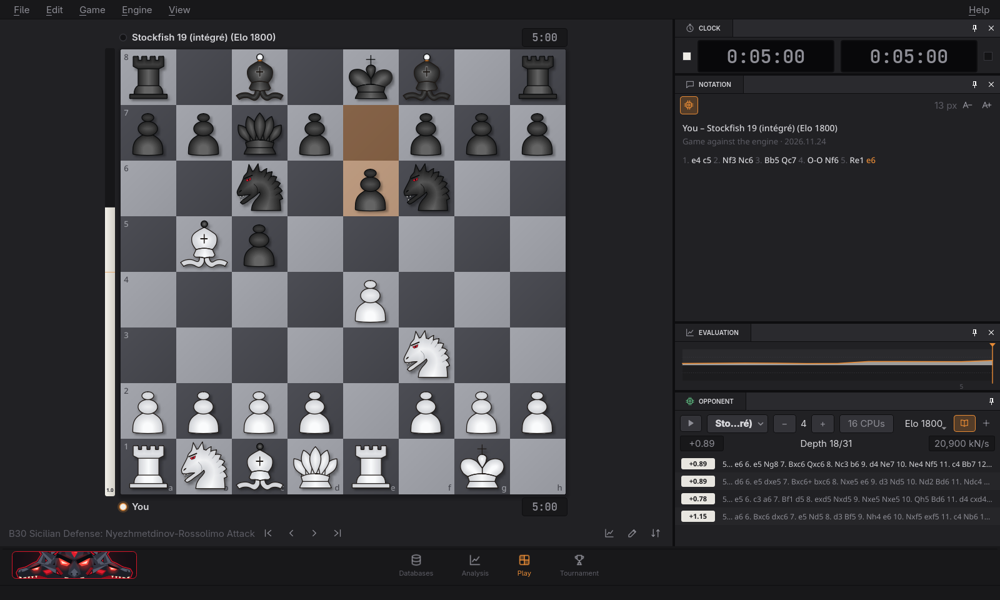
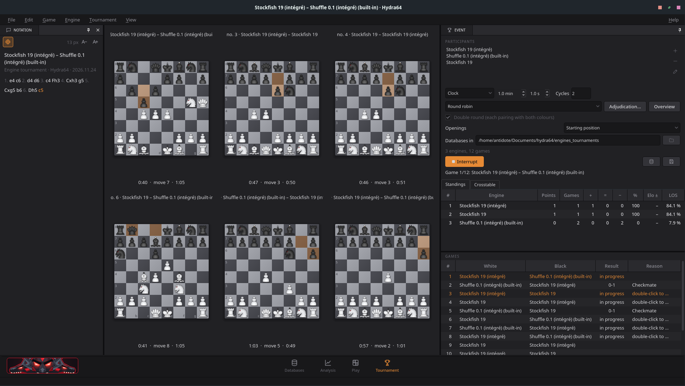

# Hydra64

**A chess workbench for Linux and Windows: databases, analysis, play and engine tournaments in one
dark, dockable interface.** C++20 / Qt 6, free software (GPL-3).

**Website: <https://antidote1911.github.io/Hydra64/>** — tour, downloads, manual.

[](https://github.com/Antidote1911/Hydra64/actions/workflows/tests.yml)
[](https://github.com/Antidote1911/Hydra64/actions/workflows/release.yml)
[](https://github.com/Antidote1911/Hydra64/releases/latest)
[](LICENSE)




## What makes it different

- **Your proprietary databases, converted without loss.** ChessBase (`.cbh`, `.2cbh`), Chess
  Assistant / Aquarium databases and `.ctg` / ChessOK opening books are converted to an open,
  documented format — the 11.7 million games of the Mega Database 2026 in 25 seconds, every game
  checked against the source one by one. No game is dropped, and no Windows or Wine is needed.
- **Fast on very large databases.** An 11-million-game database opens in 13 ms; sorting a column
  takes a fraction of a second, a position search a few tens of milliseconds. The format is
  specified in [`docs/format-hy64db.md`](docs/format-hy64db.md) and a database can be a single
  `.hy64` file, editable in place.
- **Four pages, one window.** *Databases*, *Analysis*, *Play* and *Tournament* each keep their own
  game, layout and engines; panels dock, float and stack as in a video editing suite (the theme is
  inspired by DaVinci Resolve).
- **Tools for preparing and understanding.** Preparation report against a player (their tree,
  their weak lines, where they leave your repertoire), report of a player's costliest mistakes,
  searches by manoeuvre, pawn structure or material, deep analysis projects, a coach while you
  play.
- **Engine tournaments that share their results.** Round robin or gauntlet, simultaneous games,
  adjudication, Elo difference ± margin and LOS, and a standalone HTML page with a replay board.
- **Ready out of the box.** Stockfish is built in, along with 1,000 master games, training
  positions and the usual tournament opening collections; Chess960 is supported throughout.

| Databases | Play |
|---|---|
|  |  |

**Engine tournament** — six games at once, standings with LOS, game list:



The interface is available in **English and French**, and so is the full user manual (every page,
every feature, all file types): **[read it online](https://antidote1911.github.io/Hydra64/manual/)** — EN / FR
buttons at the top right. It is the file [`Manual.html`](Manual.html) of this repository, which
also opens in a browser without a connection.

## Building and running

```sh
sudo pacman -S --needed qt6-base qt6-svg qt6-tools cmake git rust stockfish
./build.sh                # Release build in build/
./run.sh                  # builds if needed, then starts the application
./run.sh tests/data/classics.pgn --page analyse
```

Options of `build.sh`: `--linux` (default), `--win` (see "Windows version" below), `debug`
(`build-debug/` folder), `asan` (ASan + UBSan in `build-asan/`, without Stockfish: copy
`build/stockfish` into `build-asan/` before running `ui_tests`), `--clean`, `--test`.
The tests cover the chess core (perft, PGN), Shuffle (Rust) and the interface
(`tests/ui_tests.cpp`: real window off screen, configuration isolated in the build folder).
`run.sh` passes its arguments on to the application; `BUILD_TYPE=Debug ./run.sh` starts the debug build.
Optional tests on real data: `HYDRA64_TEST_2CBV=<.2cbv archive>` (ChessBase 18),
`HYDRA64_PLAYBASE=<Playbase folder>` (players encyclopedia, `core_tests` and `ui_tests`),
`HYDRA64_TEST_HY64` / `HYDRA64_TEST_CBH` (ChessBase database, see below).
The script of the exported HTML pages is run by Qt's JavaScript engine (Qt6Qml) if it is installed.

### User folder

Everything Hydra64 reads or writes for the user, apart from settings, is in a single folder:
`~/Documents/hydra64/` on every system — `Documents\hydra64\` on Windows (`HYDRA64_HOME`
environment variable for another location). The `~/Documents/hydra64/…` paths of this document are to be
understood that way.

    hydra64/
      databases/      game databases: the bundled ones (copied there at first launch) and your own
      openingbooks/   opening books — created empty
      tablebases/     endgame tablebases — created empty
      uci_engines/    your UCI engines — created empty (the built-in Stockfish and Shuffle are not here)
      engines_tournaments/   databases of the engine tournaments — created empty
      exercises/  analyses/  repertoire/  themes/     created when they are needed

At launch, `userdirs::install()` creates `databases/`, `openingbooks/`, `tablebases/`, `uci_engines/`
and `engines_tournaments/` and copies
into `databases/` the folders shipped with the program (`games`, `training`, `tournament-openings`,
`engine-tests`) that are not there yet: a folder that is already present is never touched again, and
a database you edited or deleted there stays as you left it. Training, tournaments and the solution
test read the bundled databases from this folder.

File choosers open first in the folder of the requested kind — a database: `databases/`, an opening
book: `openingbooks/`, tablebases: `tablebases/`, a tournament opening collection:
`databases/tournament-openings/`, an engine test: `databases/engine-tests/` — then wherever you went
last time for that kind of file (`src/ui/userdirs.*`).

### Bundled databases: the `databases/` folder

It is distributed as it is (copied next to the executable, and into the Windows archive) and only
contains **single-file Hydra64 databases** (`.hy64`) and their notices:

    databases/
      README.html                  overview
      games/                       Masters_1000.hy64: 1,000 master games, 1834 – 2024, without comments
      training/                    mates/mate_in_1…5.hy64, best_moves/best_move_easy|medium|hard.hy64
      tournament-openings/         UHO_2022_*, 8moves_v3, 2moves_v2, Drawkiller_balanced_big, Nunn_10, Nunn2_25
      engine-tests/                Tactics_Marathon_210.hy64

Each folder has its `README.html` notice, in French and English (EN / FR buttons, choice remembered
as on the exported HTML pages). They are produced by `tools/databases/make_readmes.py` (text in the
script, style `readme.css`, logo `resources/hydra64.svg`): edit the script then run it again. The game sample is
chosen by `tools/sample-games/select.cpp` from a large reference database (reproducible choice,
moves and headers only). The ECO codes, compiled into the program, are kept apart:
`resources/eco-opening/`.

### Windows version

```sh
sudo pacman -S --needed mingw-w64-gcc && rustup target add x86_64-pc-windows-gnu
./build.sh --win          # built from Linux in build-win/, archive build-win/Hydra64-windows.zip
./build.sh --win --clean  # from an empty configuration (downloaded Qt kept)
```

The archive contains a `Hydra64` folder to unzip anywhere (nothing to install):
`hydra64.exe`, `hydra64-convert.exe`, Stockfish and Shuffle, the Qt DLLs, the `databases/`
folder. Windows 10 (1903) or 11, 64-bit, processor with AVX2 (Stockfish).

How it is done: the machine's MinGW compiler (UCRT), prebuilt Qt 6 and zlib taken from the MSYS2
"ucrt64" packages (`tools/windows/fetch_sysroot.py`, once, into `build-win/sysroot/`), and the
`moc` / `rcc` / `lrelease` tools of the machine's Qt — hence the same Qt version on both sides,
checked by the script. Toolchain file `cmake/mingw-w64.cmake`; `tools/windows/package.py` gathers
the programs and the DLLs they depend on. Our programs embed their C++ library
(`-static-libstdc++`): that of the machine's MinGW and that of MSYS2 are not interchangeable.
A manifest (`resources/windows/`) puts file paths in UTF-8. File offsets are 64-bit everywhere
(`src/db/fileoffset.h`): databases over 2 GB work.

Differences from Linux: no endgame tablebases in ISO images (FUSE); no tests; no installer.

The archives of the GitHub releases (`.github/workflows/release.yml`, run by pushing a `v*` tag)
are built on a Windows machine instead, with MSYS2 "ucrt64" — its MinGW, its Qt, its Rust — and
packed by the same `tools/windows/package.py`.

The **Qt Advanced Docking System** (v5.1.1, LGPL 2.1) is downloaded by CMake (`FetchContent`) at
the first `./build.sh` (Internet connection needed only once), then built as a static library with
the project.

## Hydra64 databases (in-house format)

For large databases, Hydra64 has its own format: three files `Name.hy64i` (index, one 64-byte row
per game), `Name.hy64n` (names) and `Name.hy64g` (games: one byte per move, compressed text), plus
`Name.hy64p`, the position index (recomputable). On the Mega Database (11 million games): opening in
13 ms, sorting a column in 0.1 to 0.25 s, searching a player in 40 ms, tree of a position in a few
milliseconds, searching a position in a few tens of milliseconds for openings. These databases are
editable (Ctrl+S, information, deletion, "Compact database"). Specification: `docs/format-hy64db.md`.

- **Create**: File → New database… (Hydra64 format or PGN).
- **Convert**: see "Conversion" below (the Mega Database converts in under three minutes).
- **Positions**: Database → Search the board position (Ctrl+Shift+F); Database → Database tree (or
  the menu of the Opening tree panel) shows the moves played with their results.
- Tests on a real database: `HYDRA64_TEST_HY64=…/Mega.hy64i` with `HYDRA64_TEST_CBH`
  (comparison with the original ChessBase database).

## Single-file Hydra64 database (`.hy64`)

A Hydra64 database exists in two forms: **as a single file** `.hy64`, offered first by
**File → New database…** and **File → Convert…**, simpler to copy or share; or as four files
(`.hy64i`, `.hy64n`, `.hy64g`, `.hy64p`), preferable for a very large database that is edited or
reindexed often. It opens as it is, without extraction (its sections are read in place): same
opening, sorting and position-search times.

It is **editable** like an ordinary database: adding, replacing, deleting and restoring games,
flags, correcting a name, ECO classification. What is written after the file was created goes into a
journal at the end of the file, reread on opening.

**Nothing needs to be done to lose nothing**: each addition, change or deletion is written to disk
at the end of the action (in both forms of database), without waiting for closing. Under the game
list, "journal : 12 Ko" recalls what is waiting to be tidied, with the detail as a tooltip. The
journal is moved into the body of the file automatically when the database or the application is
closed once it exceeds 4 MB (a wait dialog says so), and also by **Compact database** or by
rebuilding the position index. This tidying rewrites the file alongside and only replaces it once
complete: if it is interrupted, the original database stays whole.

Going from one form to the other is just a copy: under a second for a database of 8 million games
(2.6 GB), the four files coming out byte-for-byte identical. The file is not compressed: that is
what allows opening it directly.

## Conversion (proprietary and open formats)

Proprietary formats do not open directly: **File → Convert…** converts them to the Hydra64
format or to an open format. Formats read and formats produced:

| Source | Databases produced | Trees produced |
|---|---|---|
| PGN, Hydra64 database (`.hy64i`, or single-file `.hy64`) | Hydra64 (`.hy64i`, or single-file `.hy64`), PGN | — |
| EPD positions (`.epd`, one game per position) | Hydra64, PGN | — |
| ChessBase (`.cbh`, `.2cbh` of ChessBase 18; `.cbv` and `.2cbv` archives extracted first) | Hydra64, PGN | — |
| Chess Assistant / Aquarium (`.cdp` and its files `.d00`, `.d02`, `.emb`…) | Hydra64, PGN | — |
| ChessBase book (`.ctg` + `.cto` + `.ctb`) | — | Hydra64 (`.hy64book`), Polyglot (`.bin`) |
| ChessOK / Aquarium tree (`.hsh` + `.elm`, or text export) | — | Hydra64, Polyglot |
| Polyglot (`.bin`), Hydra64 tree (`.hy64book`) | — | Hydra64, Polyglot |

The dialog offers the target format according to the source, a destination
(`~/Documents/hydra64/databases` or `~/Documents/hydra64/openingbooks`) and, for a Hydra64 database, the depth
of the position index; the result then opens (Databases page or Opening tree panel). Opening a
proprietary file (database or tree) directly offers this conversion.

- **Hydra64 tree**: everything is kept — moves, annotations, recommended / to-avoid moves, games,
  wins / draws / losses, average Elo, performance (ChessBase), highest Elo and year (Aquarium).
  Fritz 16: 11 million positions in 15 seconds, 365 MB, identical to the original book.
- **Polyglot** (open format): moves and weights only; weight = number of games, 0 for moves to
  avoid or annotated "?" / "??" (Fritz 16: 182 MB).
- **Command line**, same code: `build/hydra64-convert <source> <destination> [--positions D]` —
  the target format comes from the destination's extension (`.hy64i`, `.hy64`, `.pgn`, `.hy64book`,
  `.bin`); `--rebuild-positions base.hy64i` rebuilds the position index; `--verify <source> <base>`
  compares **all** the games of the source with those of the converted database, one by one (moves,
  variations, comments, headers), and lists the games damaged in the source (45 s for the Mega).

Reading of ChessBase databases comes from the Rust library **cbvault** 0.1.7 (MIT licence,
<https://github.com/itshak/cbvault>, independent of ChessBase; local copy with two additions for
conversion and a fix for Cyrillic comments, see
`src/chessbase/bridge/vendor/cbvault/HYDRA64.md`), used through a small C bridge
(`src/chessbase/bridge/`) built by cargo; its dependencies are pinned by `Cargo.lock` and
downloaded at the first build. Without cargo (or with `-DHYDRA64_CHESSBASE=OFF`), Hydra64
builds without ChessBase reading. Chess960 games are read (see "Chess960"). Tests on a real
database: `HYDRA64_TEST_CBH=/path/base.cbh` and `HYDRA64_TEST_HY64=/path/base.hy64i` (its
conversion), compared game by game.

Measurements of 21 November 2026 (32-thread machine), to a single-file database with the position
index at 24 half-moves:

| Database | Games | Duration | Result | Without annotations | Without moves |
|---|---|---|---|---|---|
| Mega Database 2025 (`.cbh`, texts included) | 11,151,118 | 23.3 s | 3.5 GB | 4 | 5 |
| Mega Database 2026 (`.2cbh`) | 11,740,854 | 25.1 s | 3.7 GB | 31 | 0 |

**No game is dropped**: the converted database has as many games as the source, with the same
numbers. A game damaged in the original database keeps its place:

- unreadable annotations (damaged annotation file, or a kind of annotation cbvault does not know):
  the headers and moves are kept, the comments and annotated variations are lost;
- unreadable moves: the headers are kept, without moves.

In both cases a leading comment says so ("Annotations illisibles dans la base ChessBase…",
"Coups illisibles dans la base ChessBase…"), and the conversion report lists them.

Checks of 21 November 2026:

- `--verify` on both Megas: all the games identical to the source, none different. The source and
  the database are read through two different paths of Hydra64, but both through cbvault: this
  check proves that the conversion loses and changes nothing, not that cbvault reads correctly.
- Independent cross-check: the games common to the two editions are read by two different decoders
  (`.cbh` and `.2cbh`). Of 10,770,296 games without annotation present on both sides, 10,770,113
  have exactly the same moves; the other 183 are games ChessBase retouched between the editions
  (moves swapped or corrected in old games, games completed, symbols removed), not reading errors.

The texts of a `.2cbh` database are not taken over.

**ChessBase installers on Linux**: the `Setup….exe` files of the databases, the players
encyclopedia and the opening books are NSIS archives, sometimes with a 7z archive inside. 7-Zip
opens them without Windows or Wine: `7z l Setup.exe` to look, `7z x Setup.exe -o<folder>` to
extract (and likewise on the inner `.exe` if there is one).

**Chess Assistant / ChessOK Aquarium** databases ("Chess Data Pro") are read by Hydra64 itself
(`src/db/chessassistant.*`, format described in `docs/chess-assistant-re.md`): moves, variations,
comments, headers, names; deleted games are skipped. Validated against an Aquarium PGN export
(595,565 identical games out of 595,569); 8 million games convert in 2 min 30. Chess960 games are
read.

## Preparing against a player

**Database → Statistics → Prepare against a player…** (or the button of a player's profile), on a
Hydra64 database: for the colour the player will have, the tree of what they play (games, score and
last year for each choice), the lines where they score worst and best, their openings by ECO code
and their shortest losses. A click on a number of games shows them in the list; the report exports
to HTML. Transpositions are merged: the figures of a move are those of all the games in which it
was played in that position, and a position reached by several move orders is developed once. If
you have a repertoire for your own colour (**Game → Opening repertoire**), the report lists the
player's lines that leave it — a move it does not plan, or the place where it stops.

**Error report** ("Analyser ses défaites" in the same window): the engine goes through the player's
most recent losses with that colour (30 games, 0.2 s per position by default) and keeps, in each,
the move that cost the most winning chances; the report then says in which phase and in what kind
of position those mistakes come, and lists them with the engine's move. Results are kept in
`<database>.errors.json`, next to the database (`src/ui/errorreport.*`).

## Players encyclopedia (ChessBase "Playbase")

If you own the ChessBase players encyclopedia, a player's profile (**Database → Player profile…**;
its folder is chosen in **Preferences → Databases**) also shows their photo, title, federation,
dates, Elo and world rank, and the curve of their Elo in the FIDE lists. Names are matched ignoring
case and accents: "Last, First", "Last" alone, "First Last", or the form of Chess Assistant
databases "Last First (FED)". The bottom of the profile says whether the encyclopedia is loaded.
Read-only; format described in `docs/playerbase-re.md`.

## Graphic annotations, diagrams, medals, questions

- **Arrows and marked squares**: right-click (green), `Shift` (red), `Ctrl` (yellow), both (blue);
  the same gesture erases. They belong to the displayed move and are kept in Hydra64 databases
  (codec extension) and in PGN as `[%csl …]` / `[%cal …]`, the form of ChessBase and Lichess.
- **Diagram**: right-click on a move → *Diagram after this move* ("▦" marker, `$220` in PGN; the
  "[#]" of ChessBase databases is recognised).
- ChessBase **medals**: `[%mdl n]` read move by move, displayed "★ tactique, finale", kept in the
  databases and the PGN, and carried over on conversion to the Opening / Endgame / Tactics /
  Strategy / To review flags. The meaning of the 16 bits has not been checked against ChessBase.
- **Training questions**: right-click on a move → *Training question…*; kept in PGN in ChessBase's
  `[%tqu …]` form. *Game → Train on the game's questions…* asks them one by one. The questions of a
  `.cbh` database (binary annotation) are not imported.
- **Undo / redo** (`Ctrl+Z`, `Ctrl+Shift+Z`): any change to the game, on the Databases and Analysis
  pages, 100 levels per page.

## Comments coming from ChessBase

What ChessBase stores in comments is not always meant to be read; Hydra64 handles it on
display, **without modifying the saved text** (nothing is lost in PGN or in a database):

- **Commands** `[%evp …]`, `[%eval …]`, `[%emt …]`, `[%draw …]`: never displayed. The evaluation
  profile `[%evp first,last,v0,v1,…]` (centipawns per half-move, White's side) and the
  `[%eval centipawns,depth]` are carried over to the moves when the game is opened: the evaluation
  graph is drawn at once, without waiting for Stockfish. `[%emt]` (time spent on the move) is shown
  as a time after the move ("12 s", "2:10"), with the engine notes and hidden with them.
  `[%draw arrow,e2,e4,red]` and `[%draw full,d5,yellow]` (Scid syntax) become arrows and squares
  when a PGN is read; another form of `[%draw]` stays hidden. The meaning of the values beyond
  ±30,000 (mate) is an assumption.
- **Quoted moves** in English notation ("Qh5", "Nbd7", "exd8=Q"): rewritten in the chosen
  notation, in the notation panel, the PDF and the exported HTML page (in the page's language).
  Only words with the exact form of a move are touched.
- **Private-use characters** U+E000…U+E02F (figurines and Informant signs, intended for ChessBase's
  font): rendered by the piece letter in the chosen notation or by the usual sign
  (`src/ui/display.cpp`, table taken from cbvault). Four signs without a common equivalent are
  rendered by neighbouring signs: compensation "=/∞", bishop pair "♗♗", opposite-coloured bishops
  "♗♝", passed pawn "♙↑". The exported HTML page applies the same translation.
- **Cyrillic**: `.cbh` comments in Windows-1251 are read as such (fix in the copy of cbvault, see
  `vendor/cbvault/HYDRA64.md`). A long enough comment is recognised on its own; a short comment
  ("или", "и") is recognised by its context: the database (majority of Russian in a sample of 400
  games) or the game (it already has recognised Russian). Player, tournament and site names in
  Windows-1251 are reread too ("Рандерс").
- **Pre-move comment**: ChessBase distinguishes the comment placed before a move from the one
  placed after ("by means of 8.Bd3 (or 8.Nbd2)"). Hydra64 keeps both: in PGN, a comment at the
  head of a variation, after the previous move's comment or after a variation belongs to the move
  that follows. Right-click on a move → *Comment before the move…* where the distinction exists.
  Two neighbouring variations starting with the same move stay two variations (they used to be
  merged into one).
- **Extra tags**: like ChessBase's PGN export, the conversion of a `.cbh` database sets `Annotator`
  (`.cbc` file), `WhiteTeam`, `BlackTeam` and their countries (`.cbj`, `.cbe`; team number in Roman
  numerals from 2 up), `EventDate`, `EventType`, `EventRounds`, `EventCountry`, `EventCategory`
  (`.cbt`), `SourceTitle`, `Source`, `SourceDate`, `SourceVersion`, `SourceVersionDate`,
  `SourceQuality` (`.cbs`). The tournament types ("team-swiss (rapid)"…) and the 217 country codes
  are ChessBase's, recorded over the whole Mega Database 2025; they sometimes differ from FIDE codes
  ("SIN", "DDR", "GE2" for the Saar). `.2cbh` databases give the same tags (entity file `.2lid`),
  plus `WhiteFideId` and `BlackFideId`; their 406 "analyses" (opening surveys) are games like any
  other, with their author and source. Not written: `PlyCount`, `GameId`, `Beauty`.
- **Time control and clocks**: `TimeControl` ("40/5400+30:1800+30"), `WhiteClock`, `BlackClock` and
  the clock recorded on a move (`[%clk]`) are read from the game's annotations, in both formats;
  the time per move (`[%emt]`) and the clocks are rounded to the second, like ChessBase.
- **ChessBase training questions**: the one-move question (`[%tqu]`) and the multiple-choice
  question (`[%tmc]`) are decoded in full — wording, two hints, answers with their feedback and
  points, in each language — and kept in `.hy64` databases. They are written in front of the move to
  find, as ChessBase does. Hydra64's training only uses the wording of the one-move question for
  now.
- **Diagrams**: every ChessBase diagram marker becomes "▦", whatever its form in the database;
  ChessBase's PGN export writes it sometimes as "[#]", sometimes as a raw byte, which Hydra64
  recognises too.
- **Engine evaluations**: an announced mate (`[%eval]`) is written in half-moves, like ChessBase.
- **Games without moves** (unplayed, "BYE"): returned empty, as ChessBase exports them.
- **Irregular moves**: ChessBase keeps moves the rules forbid — a king moving into check in a badly
  entered game, a pawn capture onto an empty square in a transposition note ("10.cxb6 - 9...b6").
  Hydra64 keeps them too (reading of ChessBase databases and of PGN, `.hy64` databases), instead
  of rejecting the game; an impossible move is still refused. A game whose moves stop without an
  end marker is read up to its last move.
- **Names**: the figurines of ChessBase's font in a player name or a survey title ("6.¤f3") are
  written as letters ("6.Nf3"); a lone backslash in a PGN tag is kept ("Survey\Übersicht"), escaped
  brackets are read ("\[10 sec/move\]").
- **Compared with the export of ChessBase '26** (21 and 22 November 2026): "My system" (252 games),
  two databases of the Opening Encyclopaedia 2024, the whole Mega Database 2025 (`.cbh`,
  11,149,379 games) and the whole Mega Database 2026 (`.2cbh`, 11,741,260 games). No move differs
  on the two Megas. The Russian text of "My system" differs where ChessBase's export itself loses
  the letters "ч" and "ю" or leaves a short comment badly decoded. Known gaps and figures:
  `todo.md`, "Comparison with ChessBase's own export".
- **"Commented game" flag**: set on conversion only if there is a text to read, not for a game
  that only carries commands. A database converted before 20 November 2026 keeps its old flags: it
  has to be converted again. The "with comments" search in a PGN file opened directly applies the
  same rule: commands alone do not count.

## PDF and printing

*File → Export as PDF…* and *Print the game…* (`Ctrl+P`): header, moves, variations in parentheses,
comments in italics, and a diagram at each "▦" marker (without a marker: every ten moves). A
tournament's table is printed from its HTML page.

## Merge, clipboard, repertoire

- **Merge**: several selected games → a single one with variations (right-click → *Merge*).
- **Clipboard database**: `~/Documents/hydra64/databases/Clipboard.hy64`, where to drop games from any
  database (right-click, or *Game → Add to the clipboard database*).
- **Opening repertoire** (*Game → Opening repertoire*): one tree per side in
  `~/Documents/hydra64/repertoire/` (`White.pgn`, `Black.pgn`). The report compares the displayed games
  with the repertoire: unforeseen opponent moves, lines to extend, the player's deviations, number
  of games and score.

## Index and searches by replay (Hydra64 databases)

- *Database → Index*: players (games, years, best Elo, score), tournaments, sites, annotators,
  sources. On the Mega Database 2025: 463,859 players listed in 0.4 s.
- *Search a manoeuvre…*: a piece from one square to another in N moves, with an optional via square
  (Nf3–h4–f5 on the Mega: 229,898 games in 6.4 s).
- *Search the board's pawn structure* (38 ms on the Mega thanks to the pawn signature) and *the
  board's material* (5.4 s). Exact matches.

Measurements made on 20 November 2026 on a 32-thread machine, once each.

## Texts of ChessBase databases

The texts of a `.cbh` database (introductions, lessons, tournament reports) are read directly from
the `.cbh` / `.cbg` files (`src/chessbase/cbtexts.*`, format in `docs/chessbase-texts.md`). On
conversion, each stays in its place among the games, as a game without moves: White = title, event
"Texte", plain text as a comment. *Database → Texts of the ChessBase database…* displays them
formatted. Checked on the 1,740 texts of the Mega and on a course database in Cyrillic. Not taken
over: links to games, images, texts of `.2cbh` databases.

## Chess960

Hydra64 plays, reads and saves Chess960 (Fischer random chess): castling from any starting
position, FEN with rook files (X-FEN and Shredder-FEN, "HAha"), PGN, Hydra64 databases,
ChessBase and Chess Assistant conversions. **File → New Chess960 game…** gives the starting
position of a number (0 to 959, drawn at random by default; 518 = classical position). Castling is
played by dropping the king on its rook, or on its target square (g or c). Engines receive the
`UCI_Chess960` option when the position requires it (analysis, games, tournaments with a file of
Chess960 starting positions). The position editor accepts castling rights with king and rooks on
any files. ChessOK / Aquarium trees and `.ctg` books only know classical castling: they stay silent
on a Chess960 position.

## Shuffle, the in-house engine

`engines/shuffle/` contains **Shuffle**, a UCI engine in Rust that plays silly moves, almost at
random (`Silly` or `Random` style, reproducible seed…). `./build.sh` builds it with cargo next to
`hydra64`, which adds it once to the engine manager (if it is removed, it does not come back).
The binary is standalone and usable in any UCI interface: see `engines/shuffle/README.md`.

## Engine management

**Engine → Engine management…** (Ctrl+Shift+E): add or remove UCI engines (Stockfish, Lc0,
Berserk…), check them, choose the default engine and set their UCI options (Threads, Hash,
SyzygyPath, Skill Level…). The options grid is generated from what each engine declares; changed
values appear in orange and are applied to analysis as well as to games.

The **built-in Stockfish** (built with Hydra64, see Automatic evaluation) is always in the
list, under the name "Stockfish … (intégré)": it can neither be removed nor given another
executable (its options stay adjustable), and it comes back if missing.

**Shuffle**, the home-made engine, is the second built-in engine ("Shuffle … (intégré)"): like
Stockfish it is always in the list and cannot be removed. No other engine is shipped (Berserk,
PlentyChess, Rodent IV and Shallow Blue were only there on trial until 22 November 2026; their
entries leave the list by themselves). The user's own engines go in `~/Documents/hydra64/uci_engines/`,
created empty, where "Add…" opens; the two built-in engines stay next to the program, never in that
folder, so that nobody deletes them by mistake.

In the engine manager, a built-in engine shows a short description under its name: what it is,
what it is for, then what it can do according to its own UCI options (adjustable strength, endgame
tablebases, Chess960, several lines, pondering).

Stockfish (version `sf_19`) is built from its official sources by `./build.sh` and copied next to
`hydra64`; an Internet connection is needed at the first build (sources and NNUE networks,
embedded in the binary). CMake options: `-DBUNDLE_STOCKFISH=OFF` to do without it (the system's
Stockfish is then used), `-DSTOCKFISH_TAG=…`, `-DSTOCKFISH_ARCH=…` (`native` by default;
`x86-64-avx2` or `x86-64` for a portable binary). If there is no Stockfish yet in the engine
manager, this one is added to it once.

Stockfish is under **GPL-3.0**: it is a separate program, started by Hydra64, but distributing
it with it requires providing its licence and its sources (or the means to obtain them) at the
shipped version.

**The Evaluation panel controls the evaluation**: Stockfish only runs in the background if the
Evaluation tab is displayed; closed, hidden behind another tab or folded into a side bar, it does
not compute. Reopening it (cross, or View menu) restarts the evaluation. Each page keeps its choice
(by default open on Analysis and Play, closed on Databases). **Never any evaluation on the
Tournament page**: no Evaluation panel, no bar, no Stockfish in the background, so that the
competing engines keep all the processors. **Preferences → Evaluation**: processors (2), hash
memory (64 MB), target depth (16) and maximum time per position (300 ms).

## Playing against the engine

**Game → Play against the engine…** (Ctrl+G, Play page), or "Nouvelle partie contre le moteur…" in
the list of the engine's tab: choice of side (White, Black, random), of strength (Elo 1320 to 3190,
or full strength) and of thinking time per move. You can also start from the displayed position.

The game is played only on the **Play** page, which has its own game. Changing page erases nothing;
leaving the Play page pauses the game (engine and clock stopped), it resumes on return. **Send to
analysis** (button of the Play page, Ctrl+Shift+A) copies the game played (variations, comments,
times) into the Analysis page. A game against the engine in progress at closing resumes at the next
launch with its engine, strength, time control and clocks, but **no engine starts when the
application opens**: if the opponent was to move, it stays stopped until the Play button (Space);
the spectators and the analysis of each page are stopped, to be restarted by hand. **Play** page:
board on the left, notation, evaluation graph and opponent engine's tab on the right. On this page,
**just playing a move** starts a game with the last settings used: you take the side of the piece
played, from the displayed position.

**Opponent engine's tab** (in the manner of Fritz's modules): it bears the engine's name; a click
on that name opens the list of engines to **change opponent without restarting the game** (moves,
clocks and sides kept; it also becomes the opponent of the following games), and "Nouvelle partie
contre le moteur…" at the bottom of the list opens the full settings. The tab also displays its
thinking (evaluation, depth, speed, lines). A single **Play / Stop** button (Space): it shows
**Stop** while the engine is thinking (a click stops it: moves are free for both sides, clock
stopped) and **Play** as soon as it waits, after playing its move or once stopped (a click makes it
play the side to move, you take the other; with no game in progress, this starts one). The **tab's
icon** is green when the engine is ready, red when it is working. During its thinking, a **click on
the evaluation line** (evaluation, depth, speed) or Ctrl+Space makes it play its best move found at
once. The **−** and **+** buttons set the number of lines displayed (1 to 10, 4 by default); the
**N CPUs** button (Threads option) opens the engine's settings. The **+** button at the right end
of the tab **invites a spectator engine** (menu: which one; also Engine → Add a spectator engine,
Ctrl+Shift+K): it gets its own panel under the opponent, stopped until its Play button, and its
cross removes it.

**Clock**: the time control is chosen in the "Play against the engine" dialog (Ctrl+G); on the Play
page, the clocks display the starting time before the game. Preset time controls (Bullet 1+0 / 2+1,
Blitz 3+0 / 3+2 / 5+0 / 5+3, Rapid 10+0 / 10+5 / 15+10, Classical 30+0 / 30+20), custom time
control (minutes + Fischer increment per move) and, optionally, a different time control for the
engine (handicap). "Sans pendule" keeps a fixed thinking time per move for the engine. Default:
Blitz 5+3. The engine manages its time according to the clock (`go wtime/btime/winc/binc`); it only
starts once the engine is ready. Flag fallen: game lost, or drawn if the opponent has no mating
material; playing a move (or Play) afterwards **continues the same game** — notation and clocks
kept, the fallen clock stays at 0:00 and does not fall again. The PGN records the time control
(`TimeControl`) and the time left after each move (`[%clk …]`, Lichess format), displayed again in
the player banners on replay.

**Clock panel** (**View → Clock**, on all pages): the two clocks in large, White on the left and
Black on the right, the side whose time is running framed in orange (tenths of a second under 10 s,
in red). The tab's title gives the time control ("Pendule : Blitz 5+3"). It follows the game in
progress, or the times recorded on replay. Opened from the menu, it goes above the notation.

**Coach** (option of the "Play against the engine" dialog): after each of your moves, a separate
Stockfish evaluates the position before and after the move, while the clocks are stopped. A move
that loses winning chances is reported before the opponent's reply: inaccuracy, mistake or blunder
according to the chosen threshold, with the best move. You can take your move back or play it
anyway. **Game → Hint** (Ctrl+Shift+I): a green arrow shows a good move when it is your turn. The
engine can also play at **fixed depth** (4 to 20 half-moves) instead of a time per move.
**Pondering** (option): after its move, the engine thinks during your time about the reply it
expects; if you play it, it carries on without starting from scratch (UCI `ponder` / `ponderhit`).

During the game, only your pieces can be played, and only on your turn. Going back (←, wheel,
click in the notation) lets you look through the game without the engine replaying: it only plays
at the last move ("en pause — Fin pour reprendre"). Ctrl+Z takes back your last move (and the
engine's reply). Playing a move from a past position is also a takeback: a different move leaves
the old continuation as a variation, the same move drops it, and the engine replies; **Game →
Resign** ends the game. Mate, stalemate, insufficient material, the 50-move rule and threefold
repetition are detected: the result is written in the game and displayed on the board. The analysis
panel (Analysis page) is switched off at the start of the game.

## Engine tournament

**Engine tournament** page: tick the participants (at least two engines of the engine manager, each
with its options), choose the time control (minutes + increment, in seconds), the number of rounds
and the double round (each pairing with both colours), then **Start the tournament**. Games are
played one after the other or several at a time (see "Simultaneous games" below), on the clock; the
game followed is displayed on the board with the clocks, the board then being read-only. No
evaluation on this page (see Automatic evaluation). Standings (points, +, =, −, %) and game list
are updated; double-click on a game to review it (**Tournament → Follow the game in progress** to
return to the live game). A single button depending on the state: **Start the tournament**,
**Interrupt**, **Resume the tournament** (with **New tournament** beside it to abandon it), then
**New tournament** once finished; an interrupted game is replayed. End of game: mate, stalemate,
draws by the rules, time out, illegal move, engine stopped, or draw beyond 600 half-moves.
**Export…** saves all the games as PGN. The tournament (settings, results, games) is restored at
the next launch. When a tournament starts, the centre switches to the overview.

**Pairings and time control**: round robin, or **gauntlet** (the first participant against each of
the others, to test a new version). Limit: clock, **time per move** or **fixed depth**.
**Adjudication…**:
- **draw** when both engines see an evaluation close to 0 for N moves (from a move number);
- **resignation** when both see one side losing beyond a threshold for N moves;
- evaluation, depth and time of each move as a comment in the PGN (on by default).

Also in **Adjudication…**: the engines' **pondering** (two engines compute at once).

**Simultaneous games** (in **Adjudication…**, 1 by default): several games are played at the same
time, each with its two engines and its clock — count the processors. The board follows one of the
games; to follow another, double-click it in the game list (they are marked "en cours").
**Tournament → Overview of the games in progress** (Ctrl+Shift+G, or the panel's **Overview**
button) displays all the boards at once, with the names and clocks; a click on a board shows its
game in the notation (it is marked "●"), a double-click brings it back large. Engines stay open
from one game to the next.

**Export as an HTML page** (the panel's export button, or **Tournament → Export as an HTML
page…**): a single standalone page with the standings, the crosstable, all the games and a board to
replay them (click on a move, keyboard arrows, evaluation graph, PGN download). The forced moves
(starting positions, engines' book) are in grey, followed by the mention "end of book". The page
reads in English or French (EN / FR buttons at the top right, English by default; the notation,
dates and end reasons follow). The pieces of the current set are included with their credit; no
connection needed.

**A single game** is exported in the same presentation, from any page: right-click in the notation
→ **Save the game → Export as an HTML page…**, or right-click on a game of a database's list →
**Export as an HTML page…**. The page shows the variations (clickable), comments, symbols, clocks
and evaluations when the game contains them.

The notes engines attach to their moves ("+0.23/31 2.6s": evaluation, depth, time) are hidden in
the notation with the engine button of its bar; they stay in the game and in the PGN.

**Openings** (a single choice on the panel):
- **Initial position**;
- **Starting positions**: a file, with the same position for both colours of each pairing; this is
  the fairest way to compare engines;
- **Engines' book** (Hydra64 tree or Polyglot): up to the chosen move number, as long as the
  position is in it, the move is drawn from the book (without the moves to avoid) and noted "livre"
  in the PGN. The draw is independent for each game, as in Fritz's tournaments.

The standings give the **Elo difference ± margin** (95 %) and the **LOS** (likelihood of
superiority, cutechess formulas). The **Crosstable** tab shows each engine's points against each
other one.

**Starting positions**: EPD file, PGN or Hydra64 database (`.hy64` or `.hy64i`; starting position
and moves of each game). Proprietary formats are refused: convert them first (File → Convert…).
Collections provided in `databases/tournament-openings/` (see its `README.html`), including John
Nunn's positions (`Nunn_10.hy64`, `Nunn2_25.hy64`). A tournament saved with a collection of the old
folder (`positions-depart-tournois/`, as PGN or EPD) finds today's database by itself.

## Solution test

**Engine → Solution test…**: the chosen engine searches each position of a collection for the set
time; for each position, the proposed move (live), the time since which it has held the solution,
the depth and the result; at the end, the number of positions solved and the average solution time.
Collections: EPD (operations `bm`, `am`, `id`), PGN or Hydra64 database (first move of each game
= solution, variation on the first move = another solution, or a move to avoid if it is marked
"?"). Double-click: the position in the Analysis page. Provided:
`databases/engine-tests/Tactics_Marathon_210.hy64` (Stockfish, 1 s per position: 169 / 210). Optional
full test: `HYDRA64_TEST_MARATHON_MS=1000 build/ui_tests`.

## Help

**Help** menu, at the far right of the menu bar: **About Hydra64** (version, components),
**About Qt**, and **Reset Hydra64…** which, after confirmation, puts the application back in the
state of a fresh installation: preferences, page layouts, added engines and their settings,
spectator engines, games of each page, game in progress and tournament are erased, then the
application restarts. PGN files are not touched (only forgotten).

## Preferences

**Edit → Preferences…** (Ctrl+,):

- **Language**: French or English (takes effect on restart, offered at once). Qt's standard dialogs
  follow the chosen language.
- **Move notation**: French (Cf3, Fb5, Te1), English (Nf3, Bb5, Re1) or figurines (♘f3, ♗b5, ♖e1),
  with a preview; applied immediately everywhere.
- **Navigation**: go forward / back in the game with the wheel over the board (wheel down = next
  move, direction reversible).
- **Display**: evaluation bar next to the board (also in the View menu), hidden menu bar.
- **Evaluation**: processors, memory, depth and time per position of the embedded Stockfish
  (automatic evaluation).
- **Startup**: restore the game of each page (on by default).
- **Databases**: folder of the ChessBase players encyclopedia ("Playbase"), checked as soon as it
  is chosen and applied on confirmation.

Dates are displayed DD/MM/YYYY in French and YYYY.MM.DD in English. PGN files stay in the standard
format (pieces in English, dates YYYY.MM.DD), readable by all software; a PGN in French notation
(pasted or opened) is also accepted.

### Translations

The interface is written in French; English is in `translations/hydra64_en.ts`. After adding
texts: `cmake --build build --target update_translations`, then complete the dictionary of
`translations/fill_en.py` and run it. The panel menus (ADS, originally in English) are translated
into French in `translations/ads_fr.ts` (`translations/fill_ads_fr.py`).

## Architecture

```
src/
  chess/        Pure C++ core, no Qt: rules, FEN, SAN, variation tree, PGN,
                opening trees Polyglot (.bin), ChessBase (.ctg, read-only) and
                Hydra64 (.hy64book, converted from an Aquarium tree or a .ctg),
                Aquarium / Chess Assistant trees (.hsh/.elm, direct reading)
  db/           No Qt either: Hydra64 databases (.hy64i/.hy64n/.hy64g/.hy64p, single-file .hy64:
                codec, index, searches), conversion between formats, reader of Chess Assistant /
                Aquarium databases (chessassistant), ChessBase players encyclopedia (playerbase)
  chessbase/    Reading of ChessBase databases: C bridge (bridge/) over the Rust library cbvault,
                a modified copy of which is in bridge/vendor/cbvault
  engine/       UciEngine: asynchronous control of a UCI engine; the process lives in an
                input/output thread (EngineIo) that timestamps its answers
                EngineRegistry: registered engines, reading of their UCI options
  tablefs/      Syzygy tables inside ISO images (UDF reader, FUSE)
  ui/
    theme         palette, QSS style sheet, vector icons
    display       presentation: piece notation, dates, end reasons
    preferences   general preferences (language, notation, wheel)
    userdirs      the user folder (~/Documents/hydra64) and the starting folder of file choosers
    boardwidget   board: drag and drop, click-click, arrows and marks (right-click),
                  move animation, promotion
    piecerenderer pieces (SVG sets)
    boardtheme    boards (plain squares, chosen colours or Lichess images)
    boardviewer   central viewer: players, evaluation bar, transport
    notationview  notation with variations, comments, NAGs, context menu
    enginepanel   engine lines (MultiPV), depth, speed
    bookpanel     opening tree (Polyglot, ChessBase, Aquarium, Hydra64): moves of the position
                  and statistics, double-click to play
    playenginepanel opponent engine's tab (Play, Stop, lines, CPU)
    tournament    engine tournament: pairings, games on the clock, standings
    tournamentpanel Tournament page: settings, standings, games
    tournamentoverview overview: one board per game in progress
    tournamenthtml  standalone HTML pages (tournament, single game) with a board
    playerreport    player profile; playerencyclopedia: players encyclopedia (optional)
    preparationdialog  preparation against a player: tree of his lines with one colour, weak and
                    strong lines, losses (computed by src/db/preparation)
    namefixdialog   player names rewritten as the players encyclopedia spells them
    pieceheatdialog where the pieces stand over the displayed games, first move of each piece
                    (computed by src/db/heatmap)
    guessdialog     replay of a game guessing the moves of one side, other moves judged by the engine
    assistedanalysis  target squares coloured by the quality of the move, threat as an arrow
                    (its own Stockfish process, View menu, off by default)
    errorreport     error report of a player: costliest move of each lost game, found by an engine
                    (uses the Annotator), results kept next to the database
    evalgraph     clickable evaluation graph, timeline style
    gamelist      game list and open databases: sorting, filter, columns, icons (baseicons)
    enginemanager management of the engines and their UCI options
    autoevaluator automatic evaluation in the background (graph, bar)
    chessclock    clock (Fischer time control)
    enginegame    game against the engine (dedicated UCI instance)
    playdialog    settings of a game against the engine
    positioneditor position editor
    mainwindow    ADS panels, pages (Databases, Analysis, Play, Tournament), per-page menus
tools/
  aquarium/     Aquarium scripts: export of a tree (.hsh/.elm) as text for Hydra64
  chessassistant/ reference Python reader of Chess Assistant databases (format: docs/chess-assistant-re.md)
  playerbase/   Python reader of the players encyclopedia (format: docs/playerbase-re.md)
  tournamenthtml/ check of the exported HTML pages (replay, screenshots)
  databases/    generator of the README.html notices of the databases/ folder
  windows/      Windows build: MSYS2 packages (fetch_sysroot.py), archive (package.py)
docs/           decoded formats and notes: format-hy64db.md, chess-assistant-re.md, playerbase-re.md
```

Code comments and the documentation are in English; the interface texts are written in French in
the sources and translated to English (see "Translations").

## Shortcuts

| Key | Action |
|---|---|
| ← → Home End | Navigate in the game |
| Space | Play: engine Play / Stop; Tournament: start / interrupt |
| Ctrl+G | Play against the engine |
| Ctrl+Shift+A | Send the displayed game to analysis |
| Ctrl+E | Edit the position |
| Ctrl+I | Game information |
| Ctrl+, | Preferences |
| Wheel over the board | Next / previous move |
| Ctrl+Shift+E | Engine management |
| Ctrl+Shift+K | Add a spectator engine (Databases, Analysis and Play pages) |
| Ctrl+Space | Play now: the opponent engine plays at once (Play page) |
| Ctrl+Shift+N | Annotate the game (Analysis page) |
| Ctrl+Shift+H | Advanced search in the database |
| Ctrl+Shift+G | Databases: go to game no.; Tournament: overview of the games in progress |
| Ctrl+D | Add a bookmark |
| Ctrl+Shift+R | Add the position to the exercise collection |
| Ctrl+Shift+I | Hint (Play page) |
| Ctrl+Shift+D | Start / stop the deep analysis (Analysis page) |
| Ctrl+Shift+T | Send the position to the deep analysis |
| F4 | Best line of the deep analysis into the notation |
| Ctrl+Z | Take back the move |
| F | Flip the board |
| Shift+1 / 2 / 3 / 4 | Databases / Analysis / Play / Tournament pages |
| Ctrl++ / Ctrl+− | Notation font |
| Ctrl+Shift+M | Show / hide the menu bar |
| Ctrl+Shift+C / V | Copy the FEN / paste a FEN or a PGN |
| Right-click (drag) | Arrows and marks on the board |
| Double-click on an engine line | Play its first move |

## Piece sets and boards

**Preferences → Display**: piece set and board, with a preview.

**Pieces**: SVG drawings, drawn at the exact size of the square, or images with transparency (PNG,
WebP), scaled to the square. Only the default set, *Hydra64*
(Hydra64's own, drawn by antidote1911 in 2012, CC0: round shapes shaded in steps under a dark outline, king and queen on the same
straight foot, an aggressive red-eyed knight; its SVG files are their own source), is in the code
(`resources/pieces/hydra64/`). All the others are folders of `~/Documents/hydra64/themes/Pieces/<set>/`
(twelve files `wK.svg` … `bP.svg`, or `.png`), reread each time the Preferences are opened: you add, rename or
delete some without rebuilding.

7 sets from [Lichess](https://github.com/lichess-org/lila/tree/master/public/piece), in their
original SVG files, are shipped and copied into this folder at first launch: Merida (GPLv2+, the
default set until November 2026), Celtic, Fantasy, Spatial (MIT), Firi, Papercut (CC BY 4.0),
Pixel (AGPLv3+). A button of the Preferences restores the missing ones.

Only the Lichess sets under a free licence without a non-commercial clause were taken (not the
CC BY-NC-SA, "freeware" or unlicensed ones). Authors and licences: `CREDITS.txt` of each folder
(its first line is the credit displayed). To ship another set: a folder
`resources/sets/Pieces/<set>/`, without touching the code. The formats are described in
`~/Documents/hydra64/themes/format.html` (source: `resources/sets/format.html`).

**Boards**: only *Hydra64* (default: two SVG squares in the greys of the interface, softly shaded,
`resources/board/hydra64/`, drawn by `tools/sets/make_hydra64.py`) and *Plain colours* (plain squares
in two colours chosen in the Preferences, a button for the light squares and one for the dark) are
in the code. The others are
folders of `~/Documents/hydra64/themes/Boards/<board>/`, containing either an image of the whole board
(PNG, JPEG, WebP or SVG, light a8 square at the top left), or two squares `light` and `dark`; the
colour of the coordinates is taken from the squares. The 24 boards of
[Lichess](https://github.com/lichess-org/lila/tree/master/public/images/board) (AGPLv3+; Horsey and
ChessboArt, non-commercial, are not taken) are shipped in their original files and copied at first
launch: Brown, Blue, Blue 2, Blue 3, Blue Marble, Canvas, Green, Green Plastic, Grey, IC, Leather,
Maple, Maple 2, Marble, Metal, NCF, Olive, Pink Pyramid, Purple, Purple Diag,
Wood, Wood 2, Wood 3, Wood 4; and Graphite (CC0), the plain grey-blue default board until November 2026.
Credits: `CREDITS.txt` of each folder. To ship another: a folder
`resources/sets/Boards/<board>/`.

## Command-line options

`--play blancs|noirs|hasard`, `--elo N|max`, `--movetime MS`, `--tc 3+2`, `--fen FEN`,
`--page bases|analyse|jouer|tournoi`, `--game N` (opens the game on the Databases page; with
`--page analyse`, it is sent to analysis), `--ply N`, `--engine PATH`, `--analyse`, `--engines`
(opens the engine manager), `--moves e2e4,g1f3` (plays moves as with the mouse), `--delay MS`
(delay before the screenshot), `--edit` (opens the position editor), `--save N` (saves N times to
the database before the screenshot), `--info` (opens the game information), `--prefs` (opens the
preferences), `--about` (opens "About"), `--panel NAME` (opens a panel: clock, graph…),
`--screenshot FILE` (takes a screenshot then quits: handy to check the rendering).

## Former name: Basilisk64

The program was called Basilisk64 until 22 November 2026. The file formats did not change with the
name — the magic bytes written at the head of the files still read `B64DB-…`, `B64BOOK1` and
`B64DEEP1`, so that existing files stay readable — only the extensions did: `.b64` → `.hy64`,
`.b64book` → `.hy64book`, `.b64deep` → `.hy64deep`, `.b64i/.b64n/.b64g/.b64p` → `.hy64i/…`. A
`Documents/basilisk64` folder is taken over at first launch (renamed `hydra64`, its files given
the new extensions); elsewhere, `hydra64-convert --rename-legacy <folder>` renames the files of a
folder and of its subfolders, without touching their content.

## Licence

Hydra64 is free software, distributed under the **GNU General Public License, version 3**: see
[`LICENSE`](LICENSE). It comes with no warranty. The components it embeds or downloads keep their
own licences, named in the sections that describe them (Qt, Qt Advanced Docking System, cbvault,
Stockfish, piece sets and boards).
